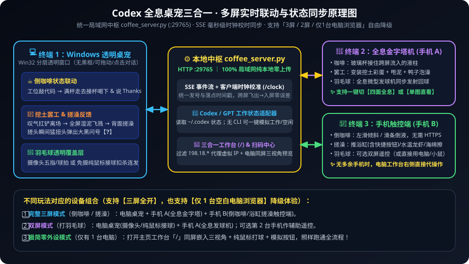
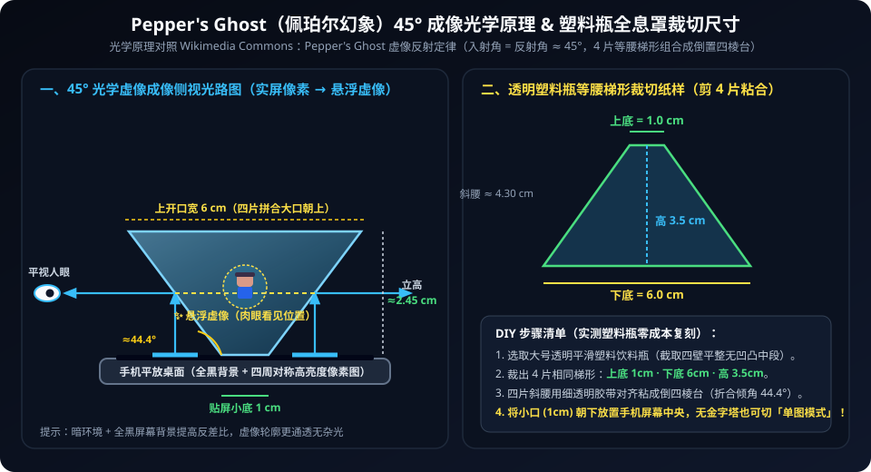
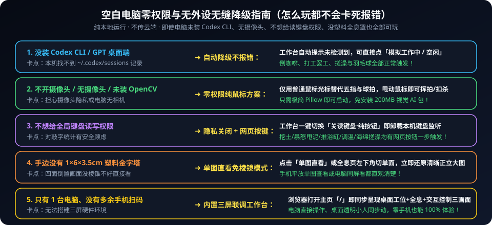

# ✨ Codex 全息桌宠三合一互动工作台（跨屏倒咖啡 · 挖土搓澡 · 透明桌面羽毛球）

> **一个透明桌面 Codex 小人，三种跨屏/单屏互动玩法，点击即可切换！**
> 支持「电脑桌面 + 塑料瓶 3D 全息金字塔 + 触控手机」三屏联动；**也 100% 支持只有一台空白电脑、无 Codex CLI、无摄像头、无多台手机、不想给键盘权限时直接纯鼠标/纯按钮完整体验。**

---

## 🎯 核心功能与玩法总览

1. **☕ 跨屏倒咖啡（三屏互动）**
   - 桌面 Codex 坐在工位前敲代码/待机；手机倾斜倒出咖啡液柱，跨屏流进全息金字塔玻璃杯；倒满 80% 时，桌面小人会惊喜起身走过去接杯喝下并说一句 `Thanks.`！
2. **🛁 电子打工仔挖土罢工 & 全息泡澡搓澡（三屏互动）**
   - 打字越猛挖土越快（也可直接点网页按钮模拟），累计疲劳触发深叹气扛铲离场、进入全息盒随机挖出彩蛋，接着暴怒 4.5 倍景深迎面朝电脑屏幕甩出一大坨挂壁湿泥！
   - 随后手机端可一键/滑动推入木桶浴缸、拧动水龙头调节水温（拧到 86°C 会烫成红龙虾跳出水面！）、用海绵擦替电脑背向搓澡去泥污——若不小心滑到头部，小人会瞬间僵住猛扭头弹出超大黑问号 `【❓】`！
3. **🏸 《我就赢了 Codex 一球，它竟然开挂了》（双屏/单屏羽毛球）**
   - **纯鼠标或摄像头双模挥拍**：桌面叠加 100% 透明鼠标穿透层，既支持电脑摄像头 21 关节点识别（切换「晴空蓝五指手套 / 发光羽毛球拍」），也完全支持**关闭摄像头用纯鼠标挥拍接球**！
   - 接球回击、高速大力扣杀触发爆裂火花音效让 Codex 愤怒减分；打赢 5 球后 Codex 当场破防掏出遥控器开挂「七球连发」，最后狼狈扔拍回工位。

> 🤖 **给用 AI Agent 帮配置的朋友**：把本项目 Git 链接发给你的 AI Agent（Codex / Claude Code / Cursor / Antigravity），直接对它说：
> **「读取这个 Git 仓库里的 `AGENT_SETUP.md`，按步骤帮我检测环境、自动配置依赖并启动工作台，让我直接完整体验！」** ——详见 [AGENT_SETUP.md](./AGENT_SETUP.md)。

---

## 🖥️ 三屏联动与跨设备同步原理



- **本地同步中枢 (`coffee_server.py` · 默认端口 `29765`)**：充当权威时钟与状态机，利用 **HTTP + SSE 长连接** 与客户端校时（`/clock`），精确计算动画从手机边缘飞出到电脑屏幕接住的毫秒级衔接；**全流程仅在本地电脑与自家局域网内传输，绝不上传任何数据到云端**。
- **支持自由组合设备数**：
  - **咖啡 / 搓澡**：标准 **3 屏**（电脑桌宠 + 全息金字塔机 + 触控交互手机）。
  - **羽毛球**：标准 **2 屏**（电脑桌宠 + 全息发球机，外加可选遥控手机）。
  - **仅 1 台空白电脑 / 零外设**：打开工作台主页 `http://127.0.0.1:29765/` 即可直接在电脑浏览器同屏看到三块联动画面并点击操作！

---

## 🔮 塑料瓶 DIY 全息金字塔与光学成像原理



本项目全息画面基于经典的 **Pepper's Ghost（佩珀尔幻象）45° 光学虚像反射原理**（可参考 Wikimedia Commons 公开光学资料：[`Category:Pepper's ghost`](https://commons.wikimedia.org/wiki/Category:Pepper%27s_ghost) 及 [`File:Pepper's ghost with video screen.jpg`](https://commons.wikimedia.org/wiki/File:Pepper%27s_ghost_with_video_screen.jpg)）。

- **塑料瓶裁切黄金参数（零成本复刻）**：
  - **材料**：透明矿泉水瓶或大号饮料瓶中段**四壁平整光滑**的透明硬塑料（也可用透明 PVC/亚克力薄片）。
  - **尺寸**：裁剪 **4 片相同等腰梯形**——**上底 `1 cm`**、**下底 `6 cm`**、**梯形高 `3.5 cm`**（斜腰长约 `4.30 cm`）。
  - **为什么刚好有效？** 4 片梯形拼成倒四棱台后，垂直立高 $\approx \sqrt{3.5^2 - ((6-1)/2)^2} \approx 2.45\text{ cm}$，侧面与手机屏幕夹角恰好为 $\arccos(2.5 / 3.5) \approx 44.4^\circ \approx 45^\circ$！手机黑底发光像素经透明膜 `45°` 反射进人眼，便会形成悬浮在金字塔中心的立体虚像。
  - **没有全息金字塔怎么办？** 在手机或电脑预览页点击 **「单图直看（1 图）」**，即可免棱镜直接查看清晰正立动画！

> 📐 更详细的裁切、粘合与调光教程请见：[docs/DIY_HOLOGRAM_PYRAMID.md](./docs/DIY_HOLOGRAM_PYRAMID.md)

---

## 🛡️ 空白电脑降级 & 零权限隐私安全说明



很多朋友担心桌宠读取摄像头、键盘或需要配置复杂的 GPT/Codex 环境。我们在设计上做到了**全部敏感权限可选、无环境可一键跳过、不连接外部接口也可纯本地游玩**：

| 功能模块 | 用途与技术实现 | 隐私边界与安全说明 | 不授权 / 空白电脑如何照样玩？ |
| :--- | :--- | :--- | :--- |
| **Codex / GPT 状态读取** | 读取 `~/.codex/sessions/*.jsonl` 会话阶段事件 | 仅读取 `working`/`idle` 标签，绝不读取、发送你的对话正文 | 空白电脑无 Codex CLI 时**自动跳过**，工作台一键点 **「模拟工作中 / 空闲」** 即可体验 |
| **电脑摄像头（羽毛球）** | 本机 `OpenCV + MediaPipe` 在内存中识别 21 个手部关节点 | **不录像、不存照片、不上传云端**，可随时点击关闭 | 工作台/悬浮栏切换 **「🖱️ 纯鼠标挥拍」**，零权限移动鼠标照样扣杀，且免装 200MB AI 包 |
| **键盘敲击感应（挖土）** | Windows `WH_KEYBOARD_LL` 仅计算每秒按键次数以驱动铲土节奏 | **只统计频率数字，绝不记录、保存或发送任何按键字母与密码** | 工作台点击 **「关读键盘 · 纯按钮」** 立即彻底卸载监听，用网页按钮一样触发全流程 |
| **手机倾斜/触控（咖啡/搓澡）** | 网页触控 `PointerEvents` 滑动 + 滑条 + 按钮控制 | 避免浏览器拦截非 HTTPS 陀螺仪，无需强制手机安装任何根证书 | 无手机时在电脑工作台右侧直接点「一键满杯倾倒」「推浴缸」「搓背/搓头」触发 |

---

## 🚀 三步极速上手

### 第一步：准备基础环境（仅需 Python 3.9+ 与轻量 `Pillow`）
- **最省心方式**：双击根目录 **`4-环境依赖一键安装.bat`**；或终端只需装 5MB 核心依赖即可运行全部功能（纯鼠标羽毛球 + 咖啡 + 搓澡）：
  ```bash
  pip install -r requirements.txt
  ```
- 若想使用 **本机摄像头识别挥拍**（可选），再安装完整视觉扩展：
  ```bash
  pip install -r requirements-full.txt
  ```

### 第二步：一键拉起透明桌宠与三合一工作台
- 双击 **`0-一键启动_Codex全息桌宠三合一工作台.bat`**。
- 几秒后你会同时看到：
  1. **桌面透明背景 Codex 小人**：鼠标**单击小人**会弹出亲切对话气泡（如 `“你要给我倒咖啡吗？☕”`），按住可拖动位置，右键菜单或左下角快捷条随时切换功能；
  2. **三合一网页工作台 (`http://127.0.0.1:29765/`)**：同屏显示多端实时画面、手机扫码二维码、以及零权限/模拟状态切换开关。

### 第三步：体验全部三模式（单人单机 or 手机扫码联动）
- **只想自己先在电脑玩**：直接在工作台顶部切换 `☕ 倒咖啡` / `🛁 搓澡罢工` / `🏸 羽毛球`，点快捷操作按钮就能看桌面透明小人实时动起来！
- **想配手机/全息罩一起玩**：让手机与电脑连在同一个 Wi-Fi 下，用手机相机扫工作台下方的二维码即可进入对应手机页。
- **退出关闭**：点桌面控制条或工作台右上角 **「停止全部」**，或双击 **`6-停止桌宠与后台服务.bat`**。

---

## 🌐 多设备网络配置与网页限制避坑要点

1. **必须处于同一局域网（同一路由器 Wi-Fi）**：如遇公司/校园网开启「AP 客户端隔离」导致手机扫不通电脑，可改用家用 Wi-Fi 或手机开启个人热点让电脑连上。
2. **避开代理虚拟网卡（Clash / VPN）**：系统开代理常产生 `198.18.*` 虚拟 IP。连接向导已自动过滤虚拟网卡，如扫码仍不通，请在工作台 IP 下拉框中选回 `192.168.*` 真实局域网 IP。
3. **Windows 防火墙放行**：首次运行弹出 Windows 安全警报时，请勾选「专用网络 + 公用网络」并允许 Python 通信 `29765` 端口。
4. **手机浏览器常见限制规避**：
   - **无法自动播音效**：iOS Safari / 微信内置浏览器 / Chrome 要求用户至少点击一次屏幕才解锁音频，进入全息/触控页后轻触画面或点 **「开启声音」** 即可；
   - **HTTP 下禁用手机摄像头与陀螺仪**：因此我们把摄像头动捕放在电脑本机（`127.0.0.1` 属于浏览器安全上下文），手机交互页用「触控滑动 + 按钮」完美绕过 HTTPS 证书门槛；
   - **全屏防熄屏误触**：全息页右上/底部提供 **「⛶ 全屏清屏模式」**（双击退出），放全息金字塔上纯净黑底无干扰。

> 📘 完整排障细节见：[docs/NETWORK_AND_SANDBOX_GUIDE.md](./docs/NETWORK_AND_SANDBOX_GUIDE.md)

---

## 📂 目录结构与所用技术栈

- **桌面透明渲染**：Python `tkinter` + Win32 `UpdateLayeredWindow` / `LWA_COLORKEY`（无黑框、全屏点击穿透或可拖拽互动）
- **实时多屏引擎**：Python 标准库 `ThreadingHTTPServer` + SSE (`text/event-stream`) + 客户端毫秒时钟校准 (`coffee_server.py`, `strike_engine.py`, `app/badminton_live.py`)
- **网页前端**：原生 HTML5 Canvas 像素动画 + 无构建零依赖 ES6（`coffee/workbench.*`, `coffee/coffee.js`, `coffee/pixel.js`, `coffee/strike_holo.js`, `coffee/badminton_holo.js`）
- **核心文件一览**：
  - `0-一键启动_Codex全息桌宠三合一工作台.bat`：主启动入口
  - `coffee_server.py`：本地三合一后台服务与状态协同中枢
  - `coffee_pet.py` / `strike_desktop.py`：桌面倒咖啡 & 挖土/湿泥/搓澡透明桌宠
  - `app/badminton_overlay.py`：桌面羽毛球透明层（支持摄像头 21 点 & 纯鼠标无摄挥拍）
  - `docs/`：塑料瓶 DIY 教程、网络避坑手册及光学/三屏架构 SVG 矢量图
  - `tests/`：核心物理、状态机与空白电脑全链路自动化测试
