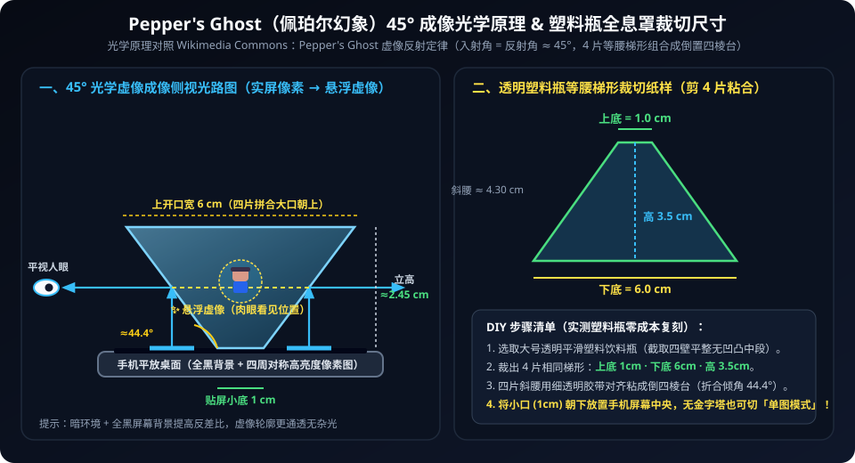

# 🔮 塑料瓶 DIY 全息金字塔制作与调光指南

## 一、材料准备
- **推荐材料**：2L 透明大号碳酸饮料瓶或矿泉水瓶**中段平直无花纹瓶壁**（若想质感更佳，也可用 `0.3mm ~ 0.8mm` 透明 PVC 硬片或亚克力板）。
- **工具**：直尺、油性记号笔、美工刀/剪刀、透明窄胶带（热熔胶亦可）。

## 二、精确裁切尺寸（实测可用，对应 ~45° 黄金反射角）
用直尺在平整塑料片上画并剪下 **4 片完全相同的等腰梯形**：
- **上底**：`1.0 cm`
- **下底**：`6.0 cm`
- **梯形高**：`3.5 cm`（两条斜腰长约 `4.30 cm`）

> 为什么用这组比例？
> 4 片拼成倒四棱台后，底边与顶边单侧水平差值为 $(6 - 1)/2 = 2.5\text{ cm}$，在梯形面高 $3.5\text{ cm}$ 的情况下：
> - 棱台立体高度 $H = \sqrt{3.5^2 - 2.5^2} \approx 2.45\text{ cm}$
> - 与手机屏幕夹角 $\theta = \arccos(2.5 / 3.5) \approx 44.4^\circ$，非常贴近经典 **Pepper's Ghost `45°` 光学虚像反射角**！

## 三、粘合与摆放技巧
1. 把 4 片梯形腰边两两对齐，用细透明胶带在**外侧**粘牢（避免内壁胶痕影响反光）。
2. 将手机平放桌面，打开全息页面（`/coffee/holo?faces=4` 或 `/badminton/holo?faces=4`），点选 **「⛶ 全屏清屏模式」** 隐藏周围按钮。
3. 把全息金字塔**小底口 (`1 cm`) 朝下**放于手机四象限十字中心。
4. 适当调暗室内顶灯、将手机亮度拉到 80%~100%，平视金字塔中腰即可看见通透悬浮的小人虚像！
5. **没有棱锥也想先体验？**：在工作台把「全息显示模式」切为 **「单图直看」**（或 URL 带 `?faces=1`），画面会自动还原成清晰正立大图。
