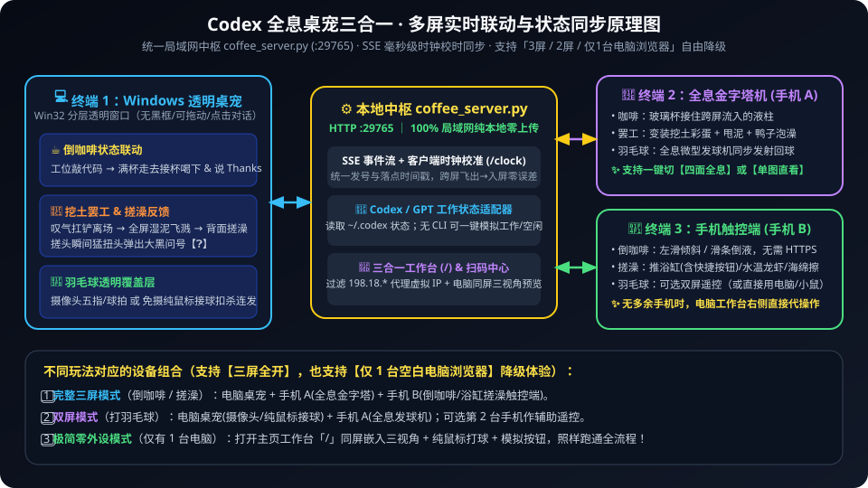

# 🌐 多设备 Wi-Fi 配置与浏览器限制完全避坑手册

## 一、多手机连接同一个 Wi-Fi 排障清单

| 常见阻碍 | 原因分析 | 一键解决办法 |
| :--- | :--- | :--- |
| **手机扫码一直转圈/打不开** | 1. 电脑和手机不在同一局域网 2. 校园网/公司网开启了「AP 客户端隔离」拦截设备互访 | 切换到家用路由器同一个 Wi-Fi，或直接用手机开**个人热点**让电脑连入。 |
| **二维码里的 IP 是 `198.18.*` 或 `172.*`** | 开启 Clash / V2Ray / VPN TUN 模式或 WSL/Docker 生成了虚拟网卡 | `network_helper.py` 已自动降权过滤虚拟 IP；若仍选中虚拟网卡，请在工作台下拉框切回 `192.168.*` 真实无线 IP。 |
| **只有本机能开，手机连不上** | Windows Defender 防火墙拦截了外部设备访问 `29765/tcp` | 在控制面板允许 Python 通过防火墙（**公用网络与专用网络都勾选**），或临时放行入站规则 `29765`。 |
| **桌面桌宠连不上本地服务** | 系统开了全局 HTTP 代理（如 `127.0.0.1:7890`）劫持了本机回环请求 | 本程序代码全部使用 `ProxyHandler({})` 与 `--noproxy "*"` 强制直连本机，但如电脑有特殊代理驱动，请将 `127.0.0.1` 加入代理绕过列表（Bypass）。 |

---

## 二、手机/电脑浏览器安全沙盒限制说明与规避策略

为了在不折腾复杂安装的前提下保障全部体验，我们针对现代浏览器四大限制做了专门适配：

1. **🚫 网页音频自动播放限制 (Autoplay Policy)**
   - **限制**：iOS Safari、Android Chrome 与微信内置浏览器严禁网页在未获得用户手势点击前自动播放音频（`.wav`）。
   - **规避做法**：进入全息页或手机交互页后，**在页面内任意轻触一下或点击顶部/底部「开启声音」按钮**，即可唤醒所有接杯、甩泥、搓澡泡泡与羽毛球爆裂音效。
2. **🚫 非 HTTPS 局域网禁用手机摄像头与陀螺仪 (`getUserMedia` / `DeviceMotionEvent`)**
   - **限制**：所有现代手机浏览器只允许在 `https://` 加密域名下访问手机陀螺仪（真实倾斜）和手机摄像头；直接扫局域网 `http://192.168.x.x:29765` 会报硬件接口被屏蔽。
   - **为什么我们能完美绕开？**
     - 摄像头手势识别运行在**电脑本机**（Windows `OpenCV + MediaPipe` 或浏览器 `127.0.0.1` 安全上下文），无需任何跨机 HTTPS 证书！
     - 手机倒咖啡与搓澡页默认启用 **手指左滑倾倒 / 滑条倾倒 / 按钮触控交互**，直接在标准 `http://` 下丝滑畅玩、零证书报错弹窗！（如果你特别需要 iPhone 真机陀螺仪倾斜，工作台仍保留了可选本地签发 `HTTPS :29766` 证书下载面板）。
3. **🚫 微信内置浏览器长连接与全屏限制**
   - **限制**：微信自带 WebView 有顶部黑条且可能限制全屏 API（Fullscreen）。
   - **建议**：用手机系统自带相机扫码并点击 **「用 Safari / 系统浏览器打开」**，体验全屏清屏模式最佳！
4. **🚫 手机锁屏断连问题**
   - 长期摆放进全息金字塔观看时，建议临时把手机「自动锁定」设为 5 分钟或常亮，全息端在浏览器休眠恢复后会自动通过 `/clock` 与 `SSE` 重新对表接续。
